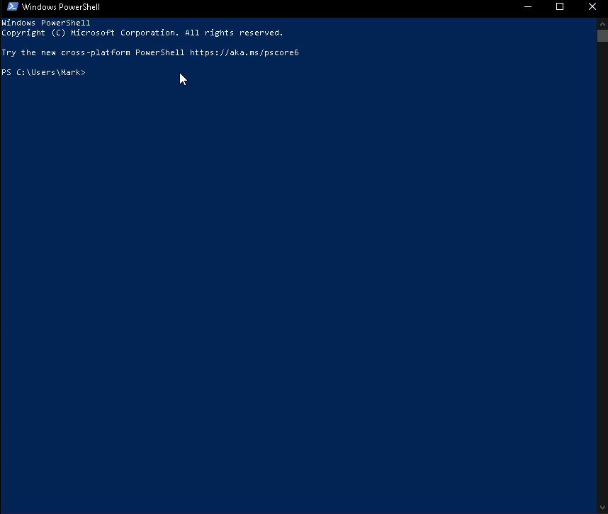

# RoboShadow Support

## Revert CIS Benchmark Fixes

Reverts all CIS benchmark fixes applied to a device by RoboShadow Cyber Heal. Removes only the CIS fix entries from local group policy (repairing the policy file and keeping any other local policy settings), removes the applied registry values, restores security options and service start types to Windows defaults, then refreshes group policy. Everything it changes is backed up to `C:\ProgramData\RoboShadow\CisRevertBackup` first. Run as Administrator; a reboot afterwards is recommended.

```powershell
iwr 'https://raw.githubusercontent.com/roboshadow/RolloutScripts/refs/heads/master/Support/Revert-CisBenchmarkFixes.ps1' -UseBasicParsing -OutFile "$env:TEMP\Revert-CisBenchmarkFixes.ps1"
powershell -ExecutionPolicy Bypass -File "$env:TEMP\Revert-CisBenchmarkFixes.ps1"
```

## Quick Diagnostic Script

```powershell
iex (iwr 'https://raw.githubusercontent.com/roboshadow/RolloutScripts/refs/heads/master/Support/RoboShadowDiagnostic.ps1' -UseBasicParsing).Content
```

## Usage Demo


